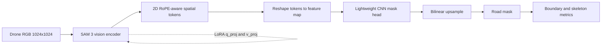

# Adapting Vision Foundation Models: Fine-Tuning SAM 3 for Drone Road Network Extraction

> Prompt-free parameter-efficient adaptation of Meta's Segment Anything Model 3, reducing trainable parameters by 97%+ while recovering thin topological road networks.

**Computer Vision · Foundation Models · PEFT / LoRA · Remote Sensing · PyTorch**

## Executive summary

Zero-shot foundation models are powerful visual feature extractors, but prompt-driven mask decoders are a poor fit for a production workflow that must extract every road pixel from an aerial tile without a point, box, or text prompt. This project adapts SAM 3's vision encoder with low-rank adapters and adds a small dense prediction head. The result is a reproducible, prompt-free binary road segmentation pipeline for Kathmandu aerial imagery.

The evaluation reports cumulative dataset-level pixel metrics, Boundary IoU with a three-pixel tolerance, and relaxed precision/recall with a three-pixel label buffer. These metrics complement one another: IoU measures area overlap, Boundary IoU measures geometric agreement, and relaxed scores distinguish a near-miss road edge from a missing road.

## Architecture

```text
1024x1024 drone RGB
        |
        v
SAM 3 vision encoder (frozen backbone + LoRA on q_proj/v_proj)
        | last_hidden_state
        v
Token sequence -> square spatial feature map
        |
        v
CNN mask head: Conv(C->128) -> Conv(128->64) -> Conv(64->1)
        |
        v
Upsample -> binary road mask -> skeleton / network analysis
```



## Scientific metrics

The test split is evaluated once using cumulative confusion counts rather than averaging per-image ratios:

- **Road IoU**: intersection over union of the predicted and reference road pixels.
- **F1 / Dice**: balances precision and recall for the road class.
- **Precision (correctness)**: how much predicted road is road.
- **Recall (completeness)**: how much reference road was recovered.
- **Boundary IoU**: boundary agreement after a three-pixel dilation tolerance.
- **Relaxed precision and recall**: accepts a configurable pixel buffer, useful for approximate hand-drawn road edges.

For network extraction, Boundary IoU and skeleton continuity matter more than pixel accuracy alone. A one-pixel shift can reduce strict IoU while preserving a usable centerline; conversely, a visually high IoU can hide a disconnected bridge or broken intersection.

## Engineering decisions

### Fixed 1024 × 1024 positional embeddings

SAM 3's 2D RoPE embeddings are configured at load time. The dataset transform, model initialization, and training configuration therefore use the same `1024` input size.

### PEFT forward routing

The PEFT wrapper is routed through `base_model` when available so SAM 3 receives only the keyword arguments supported by its vision encoder. This keeps LoRA integration explicit and avoids accidentally invoking the prompt-dependent decoder path.

### Aerial augmentations

Random rotations and flips model orientation invariance; downscaling approximates ground-sample-distance changes; grid distortion approximates orthorectification residuals; CLAHE, noise, and blur expose the model to shadow, sensor, and motion variation.

## Reproduce the benchmark

```bash
poetry install
poetry run sam3-roads train --config configs/sam3_roads.kaggle.toml
poetry run sam3-roads evaluate \
  --config configs/sam3_roads.kaggle.toml \
  --checkpoint outputs/kaggle_sam3_roads/sam3_lora_best.pth
poetry run sam3-roads export-portfolio-assets \
  --config configs/sam3_roads.kaggle.toml \
  --checkpoint outputs/kaggle_sam3_roads/sam3_lora_best.pth
```

The evaluation command writes `evaluation_metrics.json` and `portfolio_stats.json`. The asset command writes four-panel qualitative comparisons, paired slider images, and a challenge-condition panel.

## Results

The numerical cards below are intentionally populated from the generated `portfolio_stats.json`, not hard-coded. This prevents a portfolio claim from drifting away from the latest checkpoint.

| Metric | Value |
|---|---:|
| Road IoU | `{{metrics.road_iou}}` |
| F1 / Dice | `{{metrics.f1_score}}` |
| Boundary IoU | `{{metrics.boundary_iou}}` |
| Relaxed recall (±3 px) | `{{metrics.relaxed_recall}}` |
| Mean latency | `{{inference.mean_latency_ms}} ms` |
| Peak GPU memory | `{{inference.peak_gpu_memory_gb}} GB` |
